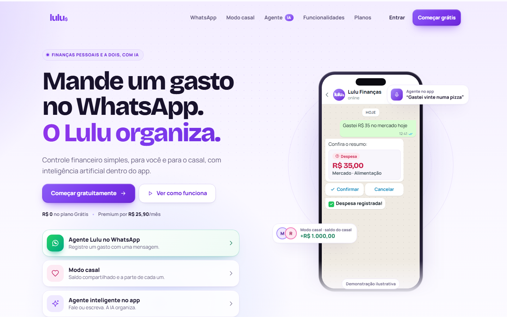
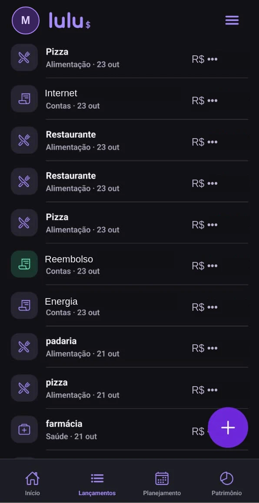
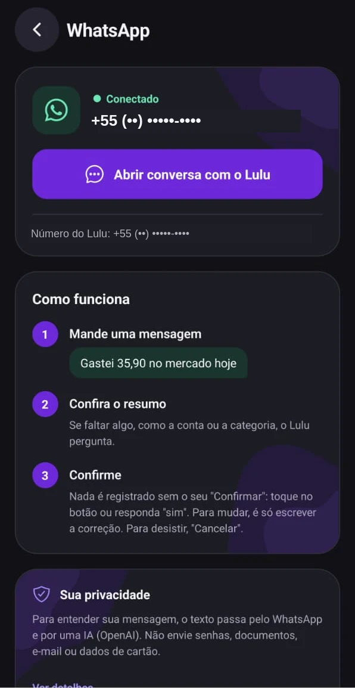
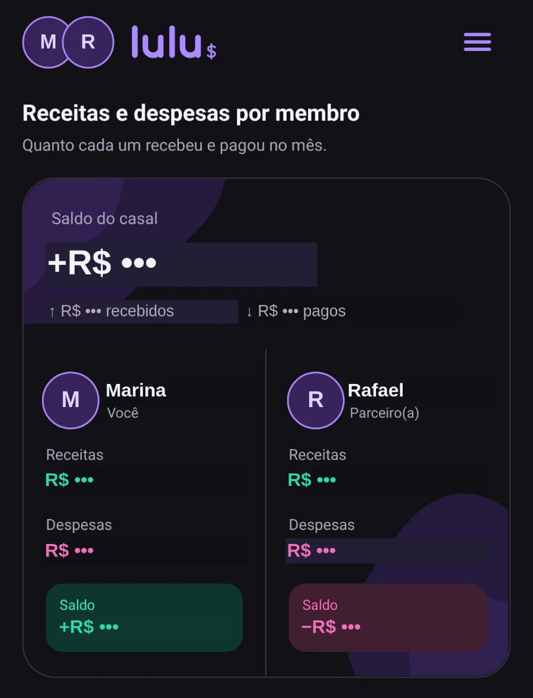
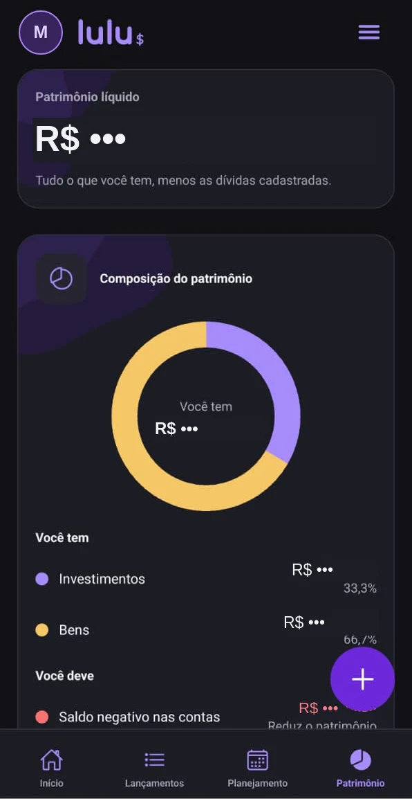
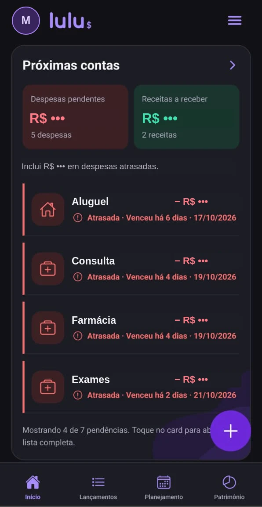
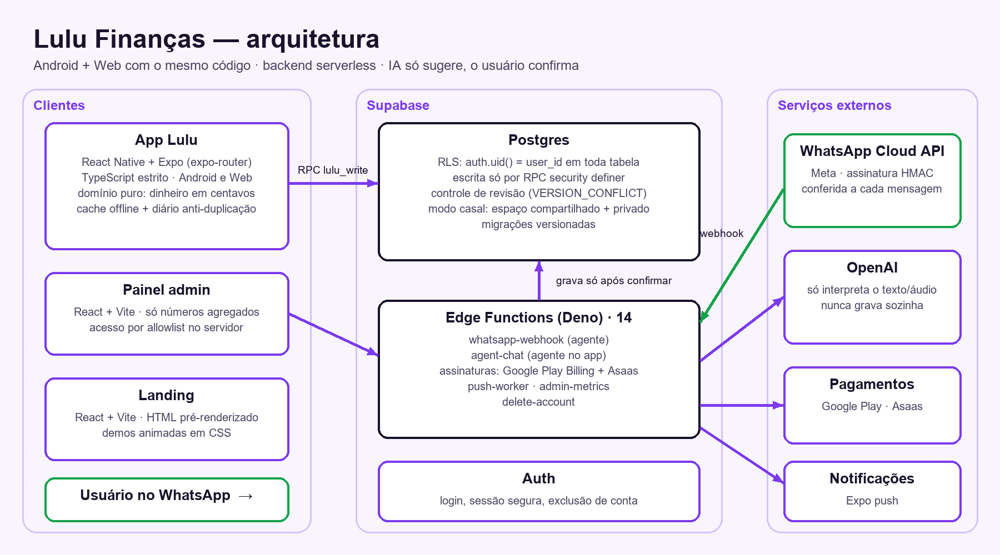

# Lulu Finanças

**Finanças pessoais e a dois, com um agente de IA no WhatsApp.**
Você manda "gastei R$ 35 no mercado", o Lulu entende, mostra o resumo e só grava depois que você confirma.

> 🔒 **Código-fonte privado** (app com dados financeiros reais). Este repositório é uma vitrine do projeto:
> o que ele faz, como foi construído e as decisões técnicas. Demonstração do código sob pedido.

## O que o Lulu faz

| | |
|---|---|
| **Agente no WhatsApp** | Registra receitas e despesas em linguagem natural (texto ou áudio). A IA só **sugere** os campos; o app valida com as próprias regras, pergunta o que faltar e grava **só depois da confirmação**. |
| **Modo casal** | Cada pessoa mantém os dados privados e o casal tem um espaço compartilhado, com saldo do casal e a parte de cada um. |
| **Agente no app** | Fala ou escreve dentro do app; mostra "como o Lulu entendeu" antes de salvar. |
| **Planejamento e patrimônio** | Contas a pagar, recorrências, cartões e faturas, orçamentos por categoria, metas, bens, investimentos e dívidas. |
| **Android e Web** | O mesmo código em React Native roda no celular e no navegador, com modo escuro e "modo simples" (fontes e botões maiores). |

## Telas

> Capturas reais do app, tratadas para publicação: nomes trocados por exemplos, fotos por iniciais e valores ocultos (`R$ •••`).

| Lançamentos | Agente (áudio → despesa) | Conectar o WhatsApp |
|---|---|---|
|  |  |  |

| Modo casal | Patrimônio | Próximas contas |
|---|---|---|
|  |  |  |

## Arquitetura

**Como uma gravação acontece (app):**
1. A tela chama o contexto de finanças; a regra de negócio fica em `domain/` (funções puras, dinheiro sempre em **centavos inteiros**).
2. Antes de gravar, o app recusa se os dados estiverem desatualizados e anota a tentativa num **diário local** (não grava duas vezes).
3. Calcula a diferença e chama uma **RPC no Postgres** com a revisão esperada.
4. O banco confere o usuário (`auth.uid()`) e a revisão — se outro aparelho gravou antes, devolve `VERSION_CONFLICT`.
5. O app publica o novo estado, salva o cache offline e redesenha.

**Como uma mensagem do WhatsApp vira lançamento:**
Meta → webhook (confere a **assinatura HMAC** e o tamanho) → quem pode usar → **cota** de consumo → trava por telefone
e **idempotência** pelo ID da mensagem → IA interpreta → regras do app completam e validam → **rascunho com token e prazo**
→ usuário confirma → o banco valida de novo e grava com **recibo** → a resposta só é enviada depois do commit.

## Segurança e privacidade

- **Isolamento total por usuário:** Row Level Security em todas as tabelas (`auth.uid() = user_id`); escrita direta
  revogada — só RPCs `security definer` com `search_path` vazio, que ignoram qualquer ID enviado pelo cliente.
- **Nada de chave sensível no app:** nenhuma `service_role` no cliente; segredos só em variáveis de ambiente.
- **A IA nunca grava sozinha** e nunca inventa dado que falta: pergunta conta, categoria, data ou valor.
- **Deduplicação em várias camadas:** ID estável do lançamento, diário de gravação, ID da mensagem da Meta, token do rascunho e recibo.
- **Ambientes separados:** banco de testes e de produção nunca se misturam.
- **Painel administrativo** só com números agregados (sem listar usuários, mensagens ou valores), com allowlist conferida no servidor.
- Exclusão de conta pelo próprio app.

## Qualidade

- **TypeScript estrito** no app e no backend.
- **66 rotinas de teste** cobrindo regras de finanças, sincronização, formulários, menus, WhatsApp, agente, modo casal,
  assinaturas, exclusão de conta, Web (Playwright) e SQL com Postgres embutido (PGlite).
- Landing com **HTML pré-renderizado** (indexável sem JavaScript), testada em 11 tamanhos de tela, zoom, movimento reduzido e sem JS.

## Em números

| | |
|---|---|
| Código do app | ~40 mil linhas em 520+ arquivos TypeScript/TSX |
| Backend | 14 Edge Functions (Deno) + migrações SQL versionadas |
| Testes | 66 rotinas, 770+ arquivos de teste |
| Projetos | app (Android + Web), painel admin, landing e páginas de privacidade |

## Tecnologias

**App:** React Native · Expo (expo-router, notifications, secure-store, local-authentication, IAP, updates) · TypeScript · React Native Web
**Backend:** Supabase (Postgres, Auth, RLS, RPC, Edge Functions em Deno) · OpenAI · Meta WhatsApp Cloud API
**Pagamentos:** Google Play Billing · Asaas
**Web:** React · Vite · CSS puro (landing pré-renderizada, pronta para Cloudflare Pages)
**Testes:** Playwright · PGlite · react-test-renderer

---

Feito por <a href="https://github.com/lucianofonsecadev">Luciano Fonseca</a> · Brasília

